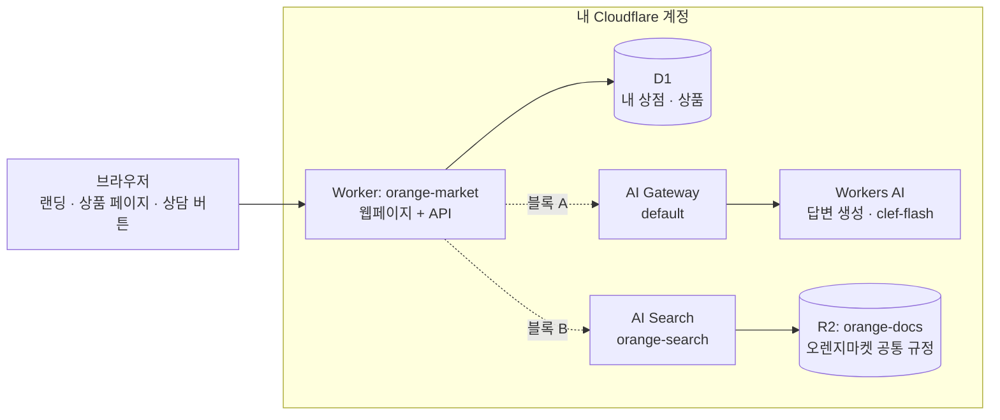
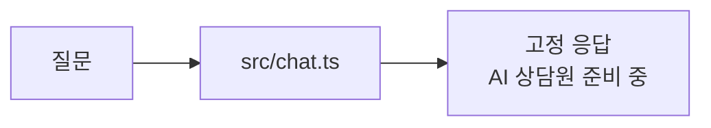
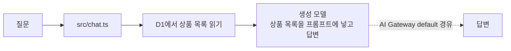
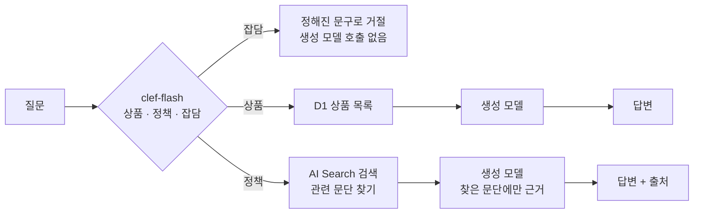

# 오렌지마켓 구조

이 문서는 오렌지마켓이 어떻게 생겼고, 요청이 어디를 거쳐 가는지 설명합니다. 모든 리소스는 내 Cloudflare 계정 하나 안에 있습니다.

## 한눈에 보기



점선은 처음에는 꺼져 있다가 주석을 풀면 켜지는 연결입니다. R2와 AI Search는 1단계에서 `npm run setup:docs`로 내 계정에 만들어 둡니다.

## 구성 요소

| 구성 요소 | 무엇을 하나 | 코드에서 | 언제 생기나 |
| --- | --- | --- | --- |
| Worker `orange-market` | 웹페이지를 내보내고 `/api/*` 요청을 처리 | `src/index.ts` | 1단계 `npm run deploy` |
| Static Assets | `public/`의 HTML·CSS·JS를 그대로 내보냄. 빌드 단계 없음 | `wrangler.jsonc`의 `assets` | 1단계 |
| D1 | 상점 정보와 상품. 사람마다 각자의 데이터베이스 | `env.DB` | 1단계 첫 배포 때 자동 생성 |
| Workers AI | 상담 답변을 만드는 생성 모델과, 질문을 분류하는 clef-flash | `env.AI` | 3단계 (블록 A) |
| AI Gateway `default` | 모든 AI 호출의 로그·토큰·비용을 모으는 관문 | `env.AI.run(..., { gateway: { id: "default" } })` | 3단계 첫 AI 호출 때 자동 생성 |
| AI Search `orange-search` | R2의 정책 문서를 색인하고, 질문과 관련된 문단을 찾아 줌 | `env.SEARCH` | 1단계에서 `npm run setup:docs`로 생성, 4단계(블록 B)에서 연결 |
| R2 `orange-docs` | 정책 문서 원본 5종 | 코드에서 직접 쓰지 않음 | 1단계에서 `npm run setup:docs`로 생성 |

## 파일 구조

```text
orange-market/
├ public/                  웹페이지 (Static Assets)
│ ├ index.html             랜딩
│ ├ product.html           상품 상세
│ └ assets/
│   ├ style.css            디자인
│   ├ app.js               /api/shop, /api/products로 화면을 그림
│   └ chat-widget.js       오른쪽 아래 상담 버튼과 채팅창
├ src/
│ ├ index.ts               라우팅
│ ├ chat.ts                상담 요청 처리. 블록 A·B 스위치가 여기 있음
│ ├ ai.ts                  블록 A: 상품 목록 + 생성 모델
│ ├ rag.ts                 블록 B: clef-flash 분류 + AI Search 검색
│ └ env.ts                 바인딩 타입 (AI·SEARCH는 블록을 풀어야 생김)
├ migrations/0001_init.sql D1 스키마 (shop, products 테이블)
├ seed/                    D1에 넣을 데이터 (2단계에서 AI가 바꾸는 곳)
│ ├ shop.json              상점 이름·소개·컨셉·테마
│ └ products.json          상품 목록
├ scripts/
│ ├ check.mjs              가드레일 검사 (npm run check)
│ ├ seed.mjs               seed/를 D1에 넣음 (npm run deploy가 실행)
│ ├ lib/validate.mjs       seed 데이터 형식 검사. check와 seed가 같이 씀
│ └ protected.lock.json    고치면 안 되는 파일의 목록과 해시
├ docs/policies/           정책 문서 5종 (R2에 올라간 원본의 사본)
├ agents/                  AI 에이전트 규칙
│ ├ guardrails.md          고쳐도 되는 파일과 안 되는 파일
│ └ workflows/customize-shop.md  상점을 만드는 순서
├ AGENTS.md, CLAUDE.md     AI 에이전트가 처음 읽는 파일
├ ops/                     R2·AI Search를 준비하는 스크립트 (npm run setup:docs)
├ README.md                따라 하는 순서
├ package.json             명령어(deploy · check · preview)와 wrangler 버전
└ wrangler.jsonc           Worker 설정과 바인딩. 블록 A·B 스위치가 여기도 있음
```

## API

| 경로 | 하는 일 |
| --- | --- |
| `GET /api/shop` | 상점 이름·소개·테마 |
| `GET /api/products` | 상품 목록 |
| `GET /api/products/:id` | 상품 하나 |
| `POST /api/chat` | 상담. 요청 `{ message, history }`, 응답 `{ reply, route, sources }` |
| `GET /api/health` | 어떤 바인딩이 켜져 있는지 (`DB`, `AI`, `SEARCH`) |

`route`는 답이 어디서 나왔는지 알려 줍니다. `fixed`(고정 응답) · `model`(3단계) · `product` · `policy` · `off_topic`(4단계) 중 하나입니다. 상담 창은 `sources`가 있으면 답 아래에 출처 문서 이름을 보여 줍니다.

## 상담 요청이 지나가는 길

### 1·2단계 — 블록이 모두 꺼져 있을 때



### 3단계 — 블록 A를 켰을 때



상품 질문은 D1 데이터를 보고 맞게 답합니다. 정책 질문은 근거가 없어 제대로 답하지 못합니다.

### 4단계 — 블록 B를 켰을 때



## 왜 이렇게 나눴나

- **정형 데이터는 D1, 문서는 AI Search** — 가격·재고처럼 정확해야 하는 값은 데이터베이스에서 그대로 읽습니다. 규정처럼 글로 된 지식은 검색해서 근거로 씁니다.
- **분류를 먼저 한다** — 검색 점수만으로 거절하면 D1에 있는 상품 질문까지 거절됩니다. clef-flash는 허용한 답마다 확률을 돌려주는 decision model이라, 상품·정책·잡담 중 어디로 보낼지 빠르게 정할 수 있습니다.
- **잡담에는 생성 모델을 쓰지 않는다** — 답할 필요가 없는 질문에 토큰을 쓰지 않습니다. AI Gateway Logs에서 이 차이가 보입니다.
- **모든 AI 호출은 AI Gateway로** — 어떤 질문에 어떤 모델이 얼마나 썼는지 한곳에서 봅니다.
- **스위치는 주석 한 줄** — 로직은 `src/ai.ts`, `src/rag.ts`에 미리 들어 있고, `src/chat.ts`와 `wrangler.jsonc`의 주석 한 줄씩이 이를 켭니다. 바인딩을 연결하는 것과 코드에서 쓰는 것이 각각 한 줄이라는 점을 직접 느껴 보세요.
